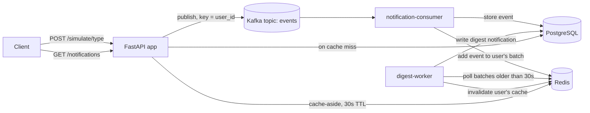

# Real-Time Notification System

An event-driven notification backend. Order, payment and delivery events are
published to Kafka, stored in PostgreSQL, grouped per user into short digest
notifications ("You have 2 order updates, 1 payment update."), and served
through a Redis-cached API. The whole stack runs locally with Docker Compose
and deploys to AWS with Terraform.

**Stack:** Python · FastAPI · Apache Kafka · PostgreSQL · Redis · SQLAlchemy ·
Alembic · Docker · Terraform · AWS (EC2, ALB, Auto Scaling) · Locust

## Architecture



1. **Publish:** `POST /simulate/{order|payment|delivery}` builds an event and
   publishes it to the `events` topic, keyed by user ID so each user's events
   stay in order on one partition.
2. **Consume:** `notification-consumer` stores each event in PostgreSQL and
   appends its ID to that user's batch in Redis. Offsets are committed only
   after the event is stored, so a crash means redelivery, not data loss.
3. **Digest:** `digest-worker` checks every 5 seconds for batches whose
   30-second window has closed, turns each one into a single notification,
   links the events to it, and clears that user's cached notification list.
4. **Read:** `GET /notifications` serves from Redis when it can and falls back
   to PostgreSQL on a miss, caching the result for 30 seconds. Every response
   carries an `X-Cache: HIT` or `X-Cache: MISS` header.

## Design decisions

- **Kafka between the API and the workers.** The API only has to hand the
  event to the broker, so traffic spikes queue up in Kafka instead of
  overloading the database, and consumers can be scaled or restarted
  independently.
- **Batching into digests.** A burst of events for one user becomes one
  notification instead of many. Batches live in Redis, and the flush uses an
  atomic `RENAME`, so an event that arrives mid-flush lands in the next batch
  instead of being lost.
- **Cache-aside with invalidation.** Notification lists are cached per user,
  and the cache is deleted whenever that list changes (a new digest is written
  or a notification is marked read). The 30-second TTL is a safety net, not
  the main way the cache stays fresh.
- **Pluggable digest text.** `app/ai/digest.py` builds the digest message
  with simple rules today. Its function signature is the integration point
  for swapping in a language-model summary later without touching the
  workers.
- **Health checks that mean something.** `GET /health` checks PostgreSQL,
  Redis and Kafka individually. The load balancer and Docker both use it.

## Running locally

Requires Docker.

```bash
docker compose up -d --build
```

This starts PostgreSQL, Redis, Kafka, the API, the consumer and the digest
worker. A one-off `migrate` container runs the Alembic migrations and seeds 50
test users (`user1@example.com` to `user50@example.com`, password
`Password123!`).

```bash
curl http://localhost:8000/health
```

Interactive API docs are at http://localhost:8000/docs.

### Try it

```bash
TOKEN=$(curl -s -X POST localhost:8000/auth/login \
  -d "username=user1@example.com&password=Password123!" | python3 -c "import sys,json; print(json.load(sys.stdin)['access_token'])")

curl -X POST localhost:8000/simulate/order   -H "Authorization: Bearer $TOKEN"
curl -X POST localhost:8000/simulate/payment -H "Authorization: Bearer $TOKEN"

# About 30 seconds later, one digest notification covers both events:
curl -i localhost:8000/notifications -H "Authorization: Bearer $TOKEN"
```

## API

| Method | Path | Description |
|---|---|---|
| `GET` | `/health` | Status of PostgreSQL, Redis and Kafka |
| `POST` | `/auth/login` | Log in with email and password, returns a JWT |
| `GET` | `/auth/me` | The current user |
| `POST` | `/simulate/{order\|payment\|delivery}` | Publish a sample event for the current user |
| `GET` | `/events` | The current user's raw events |
| `GET` | `/notifications` | The current user's notifications (Redis-cached) |
| `PATCH` | `/notifications/{id}/read` | Mark a notification as read |

## Load testing

`loadtest/locustfile.py` simulates users who log in and then mix three
actions: publishing events (weight 3), reading notifications (weight 2) and
listing events (weight 1), with 1-3 seconds between actions. Each simulated
user logs in as its own account, and notification reads are reported
separately as cache hits and misses.

```bash
python3 -m venv .venv && source .venv/bin/activate
pip install -r loadtest/requirements.txt
locust -f loadtest/locustfile.py --host http://localhost:8000 \
  --headless -u 50 -r 5 -t 5m --html loadtest/report.html
```

### Results

50 concurrent users for 5 minutes, full stack running locally in Docker on a
MacBook Air:

| Endpoint | Requests | Failures | Median | p95 |
|---|---|---|---|---|
| `GET /notifications` (cache hit) | 1,803 | 0 | 6 ms | 10 ms |
| `GET /notifications` (cache miss) | 554 | 0 | 7 ms | 12 ms |
| `POST /simulate/[type]` | 3,715 | 0 | 7 ms | 16 ms |
| `GET /events` | 1,273 | 0 | 8 ms | 16 ms |
| `POST /auth/login` | 50 | 0 | 220 ms | 240 ms |
| **All requests** | **7,395** | **0** | **7 ms** | **15 ms** |

- **Cache hit rate: 76.5%** (1,803 hits, 554 misses), so about three in four
  notification reads never reached PostgreSQL.
- **Throughput:** about 25 requests per second sustained with zero failures.
  This is the load the test generates (50 users, 1-3 s apart), not the
  system's ceiling.
- Hits and misses are almost equally fast at this data size, so the cache's
  benefit here is fewer database queries, not lower latency.
- Login is slower by design, because bcrypt password hashing is deliberately
  expensive.

## Deploying to AWS

`infra/` contains Terraform for a two-tier deployment: a data instance running
PostgreSQL, Redis and Kafka, and an auto-scaling app tier (1-3 instances,
scaling on CPU) behind an Application Load Balancer. See
[infra/README.md](infra/README.md) for setup, cost and teardown.

## Project structure

```
app/
  api/          HTTP routes: auth, simulate, events, notifications, health
  consumers/    Kafka consumer and digest worker
  producers/    Kafka producer
  services/     Batching, digesting and caching logic
  ai/           Digest message generation
  models/       SQLAlchemy models: users, events, notifications
  schemas/      Pydantic request and response models
  db/           Database session, Redis client, seed script
  core/         Settings and JWT/password helpers
alembic/        Database migrations
loadtest/       Locust load test
infra/          Terraform for AWS
```

## Known limitations

- **Notifications are pulled, not pushed.** Clients call `GET /notifications`.
  A WebSocket or server-sent events channel would let new digests reach users
  without polling.
- **At-least-once delivery.** If the consumer crashes after storing an event
  but before committing its offset, that event is stored twice on restart. An
  idempotency key per event would prevent duplicates.
- **The API waits for Kafka on every event.** `publish_event` flushes the
  producer before responding. That keeps the response honest, but a
  high-throughput producer would batch sends instead.
